<div align="center">

# SII ITC Web

### Consulta académica y organización del semestre en un solo lugar

Aplicación web conectada a los servicios REST reales del SII ITC. Permite consultar perfil, calificaciones, kardex y horario, y administrar actividades académicas personales.

<p>
  
  
  
  
</p>

[Abrir aplicación](https://sii-itc-web.vercel.app) · [Contrato OpenAPI](docs/openapi.yaml)

</div>

---

## Índice

| Sección | Contenido |
|---|---|
| [Integrantes](#integrantes-y-responsabilidades) | Equipo y contribuciones |
| [Proyecto](#proyecto-y-funcionalidades) | Objetivo y características |
| [Arquitectura](#arquitectura-general) | Frontend, proxy, Supabase y SII |
| [Frontend](#frontend) | Rutas, estado, servicios y organización del código |
| [Backend](#backend-con-supabase-edge-functions) | Funciones, integración institucional y endpoints |
| [Sesiones y seguridad](#sesiones-y-seguridad) | Cookie, cifrado, CSRF y aislamiento |
| [Base de datos](#base-de-datos-y-organizador-académico) | Tablas, reglas y cálculos del Organizador |
| [Tecnologías](#tecnologías) | Herramientas del proyecto |
| [Instalación local](#instalación-y-ejecución-local) | Ejecutar el frontend |
| [Configuración del backend](#configuración-y-despliegue-del-backend) | Secretos, migraciones y despliegue |
| [Despliegue frontend](#despliegue-del-frontend) | Vercel, rewrites y variables |
| [Capturas](#capturas-de-pantalla) | Aplicación y configuración del backend |

## Integrantes y responsabilidades

| Integrante | Perfil | Área principal |
|---|---|---|
|  | **Jesús Alejandro Elguera Tovar**<br>[@jesustovaarr](https://github.com/jesustovaarr) | Backend: Supabase Edge Functions y API; integración con SII ITC; sesiones persistentes, cookies y CSRF; migraciones PostgreSQL; operaciones y lógica del Organizador. |
|  | **Gael Gonzalez Cruz**<br>[@P4quiton](https://github.com/P4quiton) | Frontend: SPA con React y Vite; rutas y estado de autenticación; pantallas académicas y adaptación de datos; servicios HTTP; Organizador con formularios, filtros, resumen y calendario. |

## Proyecto y funcionalidades

El **Sistema Integral de Información del Instituto Tecnológico de Celaya (SII ITC)** es la fuente de verdad para autenticación y datos académicos. SII ITC Web presenta esos datos en una interfaz propia y añade un Organizador Académico con persistencia en el backend del proyecto.

| Área | Funcionalidad |
|---|---|
| Autenticación | Inicio de sesión con credenciales institucionales y sesión persistente mediante cookie segura. |
| Perfil | Información del estudiante, fotografía institucional e indicadores académicos. |
| Calificaciones | Materias, periodos y calificaciones devueltas por el SII, con búsqueda y filtro por periodo. |
| Kardex | Historial académico con filtros por materia, clave y semestre. |
| Horario | Sesiones agrupadas por día y organizadas por hora. |
| Organizador | Crear, consultar, filtrar, editar, completar, reabrir y eliminar actividades. |
| Calendario | Visualizar las actividades por mes y fecha de vencimiento.|
| Resumen | Totales, vencimientos, carga estimada, días con entregas concentradas y actividades prioritarias. |

### Recorrido principal

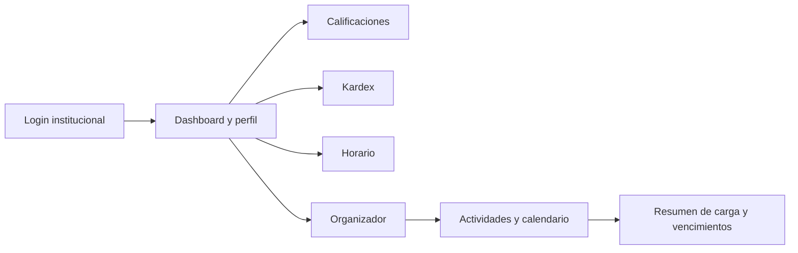

*Diagrama 1. Navegación principal.*

## Arquitectura general

El navegador consume rutas `/api/*` del mismo dominio. En producción, Vercel las reescribe hacia Supabase Edge Functions. En desarrollo local, el proxy de Vite usa `VITE_SUPABASE_URL`. Las funciones de Supabase se comunican con la API institucional y con PostgreSQL.

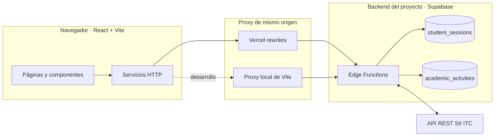

*Diagrama 2. El frontend no solicita directamente los endpoints institucionales; usa el backend como intermediario.*

| Capa | Responsabilidad |
|---|---|
| React + React Router | Renderizar pantallas, navegación, filtros e interacciones. |
| Axios (`/api`) | Enviar la clave publicable de Supabase y, automáticamente, la cookie del mismo origen. |
| Vercel / Vite | Reescribir o reenviar las rutas `/api/*` hacia las funciones de Supabase. |
| Supabase Edge Functions | Validar sesión, comunicarse con SII ITC y ejecutar la lógica del Organizador. |
| Supabase PostgreSQL | Persistir sesiones del servidor y actividades del estudiante. |
| SII ITC | Autenticar al estudiante y proporcionar sus datos académicos oficiales. |

La arquitectura usa solicitudes de mismo origen. El frontend no necesita habilitar CORS para el flujo habitual: Vercel o Vite reenvía `/api/*` y el navegador conserva las reglas de cookie del mismo origen. Las solicitudes directas de herramientas como Postman no dependen de CORS del navegador.

## Frontend

El cliente está implementado como una SPA con React 19.3.1 y Vite 8.3.5. React Router resuelve la navegación y Tailwind CSS 4 proporciona los estilos. Las pantallas obtienen los datos mediante servicios Axios dedicados; los componentes de página gestionan carga, errores y estado de interfaz. La información institucional no se simula ni se persiste en el navegador.

### Flujo de inicio y restauración de sesión

1. `AuthProvider` inicia en estado `checking` y solicita `GET /api/auth-session` al montar la aplicación.
2. Si existe una cookie válida, guarda en memoria únicamente la respuesta de sesión (vencimiento y token CSRF) y marca el estado como `authenticated`. El JWT del SII no llega al cliente.
3. Si el backend responde `401`, la aplicación queda sin sesión y `ProtectedRoute` redirige a `/login`. Ante errores de red/servidor conserva un estado recuperable y ofrece restaurar la sesión.
4. En Login se validan campos, se invoca `POST /api/auth-login` y se actualiza el contexto al recibir la nueva estructura de sesión.
5. Logout envía `X-CSRF-Token`; solo después de la confirmación local se limpia el contexto. Si el backend ya devuelve `401`, la sesión también se invalida en la interfaz.

El contexto utiliza una versión de solicitud para ignorar respuestas viejas cuando el usuario ya cambió de estado. Los componentes académicos y el Organizador usan `AbortController` para cancelar peticiones al salir de una vista y evitar actualizaciones tardías.

### Rutas

| Ruta | Página | Acceso |
|---|---|---|
| `/login` | Inicio de sesión institucional | Pública |
| `/dashboard` | Perfil e indicadores académicos | Protegida |
| `/calificaciones` | Calificaciones actuales | Protegida |
| `/kardex` | Historial académico | Protegida |
| `/horario` | Horario del semestre | Protegida |
| `/organizador` | Resumen, actividades y calendario | Protegida |

`AuthProvider` restaura la sesión al iniciar la aplicación. `ProtectedRoute` muestra estado de verificación, error recuperable o redirección a login antes de permitir acceso a las rutas privadas. `MainLayout` comparte la navegación lateral.

### Organización del código

| Carpeta/archivo | Función |
|---|---|
| `src/pages/` | Páginas de login, Dashboard, Calificaciones, Kardex, Horario y Organizador. |
| `src/features/` | Componentes de dominio: vistas académicas, lista/formulario, panel de carga y calendario. |
| `src/components/layout/` | Layout privado y navegación lateral. |
| `src/context/` y `src/hooks/` | Estado y acceso a la sesión de autenticación. |
| `src/routes/` | Protección de rutas privadas. |
| `src/services/apiClient.js` | Cliente Axios común con base `/api`, cookie y `apikey`. |
| `src/services/authService.js` | Login, restauración y logout. |
| `src/services/studentService.js` | Consultas de perfil, calificaciones, kardex y horario. |
| `src/services/organizerService.js` | Operaciones y filtros de actividades del Organizador. |
| `src/utils/` | Adaptadores de respuesta para horario y calificaciones. |

### Responsabilidad por módulo

| Módulo | Qué hace | Datos/acciones principales |
|---|---|---|
| `pages/Login.jsx` | Formulario institucional, validación de correo/contraseña, bloqueo durante envío y mensajes comprensibles para credenciales inválidas o SII inaccesible. | Llama a `loginWithSII`; tras éxito actualiza `AuthContext` y navega al dashboard. |
| `pages/Dashboard.jsx` | Solicita el perfil, presenta foto institucional (con fallback si Base64 falla) e indicadores de avance y trayectoria. | `getStudentProfile`; un `401` invalida el contexto de sesión. |
| `features/calificaciones/Calificaciones.jsx` | Tabla adaptable con materia, periodo y calificaciones disponibles; búsqueda por materia, filtro por periodo y color según el valor numérico. | Filtrado en memoria sobre la respuesta actual; mantiene calificaciones faltantes como no disponibles. |
| `features/kardex/Kardex.jsx` | Historial estructurado con porcentaje de avance, búsqueda por nombre/clave, filtro por semestre y estilo visual según calificación. | Presenta los registros `kardex` entregados por el backend institucional. |
| `features/horario/Horario.jsx` | Agrupa sesiones por día, las ordena por hora de inicio y permite consultar un día o todos. | Consume los elementos normalizados por `scheduleAdapter.js`. |
| `features/organizador/ActivityForm.jsx` | Alta y edición con materia sugerida desde el periodo actual, opción de captura manual, fecha, tipo, prioridad, estado y minutos estimados. | Valida campos en cliente y manda solo atributos editables; CSRF se agrega en el servicio. |
| `features/organizador/ActivityList.jsx` | Tarjetas con estado, prioridad, vencimiento, duración y acciones; búsqueda/filtros y paginación. | Estados pendiente, en progreso y completada; 20 elementos por página. |
| `features/organizador/ActivityCalendar.jsx` | Calendario mensual con navegación entre meses, selección de día y agenda de vencimientos. | Consulta meses paginados y presenta fechas en zona `America/Mexico_City`. |
| `features/organizador/WorkloadPanel.jsx` | Indicadores de totales, próximos vencimientos, estimación de carga, actividades prioritarias y concentración de fechas. | Los agregados y nivel de urgencia se calculan en el backend. |

### Servicios HTTP y adaptadores

`apiClient.js` crea una única instancia Axios con `baseURL: /api`, timeout de 15 segundos, `withCredentials: true`, `Content-Type: application/json` y la clave publicable de Supabase en `apikey`. No contiene el JWT institucional ni una clave `service_role`. La cookie HttpOnly es adjuntada por el navegador; el código JavaScript no la lee.

| Servicio | Operaciones |
|---|---|
| `authService.js` | Login, recuperación de sesión, logout con CSRF y traducción de errores de autenticación. Valida que el backend devuelva la estructura de sesión esperada. |
| `studentService.js` | Perfil, calificaciones, Kardex y horario; valida la forma básica de cada respuesta antes de entregarla a las páginas. |
| `organizerService.js` | Resumen, lista filtrada, consulta individual, creación, actualización y eliminación. Exige token CSRF en las mutaciones. |
| `gradesAdapter.js` | Convierte los periodos y materias de la respuesta SII al modelo de presentación de la tabla. |
| `scheduleAdapter.js` | Normaliza días, horas, docente/aula y datos de cada clase para la vista de agenda. |

Los adaptadores son una capa de presentación: no reemplazan ni inventan datos de la API institucional. Cuando el formato recibido no cumple la forma esperada, la vista informa el error en vez de asumir propiedades inexistentes.

### Navegación y estados de interfaz

`App.jsx` define `/login`, las rutas privadas y el fallback a Login. `ProtectedRoute` espera la restauración antes de renderizar contenido protegido; `MainLayout` y `Sidebar` mantienen la navegación común. Las páginas académicas muestran `LoadingSpinner`, estados vacíos diferenciados y mensajes de error; al detectar sesión inválida invalidan el contexto para volver al flujo de acceso.

En el Organizador, resumen, actividades y materias actuales cargan de forma independiente para que un error de una sección no oculte necesariamente las demás. Tras una mutación exitosa se actualizan resumen/listado, se presenta confirmación y se cierra el formulario. La eliminación pide confirmación y los controles de acciones muestran estado ocupado para evitar envíos repetidos por interacción accidental.

Las páginas académicas mantienen sus estados de carga y error y validan la forma básica de las respuestas antes de presentarlas. El identificador institucional y las transformaciones visuales se manejan desde los servicios/adaptadores y componentes correspondientes.

### Organizador y calendario en la interfaz

La página del Organizador consulta resumen, lista de actividades y materias del horario institucional. El formulario sugiere materias del SII cuando están disponibles y permite escribirlas manualmente si no hay datos. La lista permite buscar y filtrar por estado, prioridad, tipo y materia; usa paginación de 20 elementos y ofrece acciones de edición, completar/reabrir y eliminación con confirmación.

El calendario mensual consulta las actividades del mes, permite cambiar mes/año y seleccionar un día para ver sus vencimientos ordenados por hora. Muestra estados y prioridad; sus fechas se interpretan en `America/Mexico_City`. El calendario es de consulta: las modificaciones se hacen desde la lista/formulario.

El selector de materia toma las materias del periodo actual del horario cuando están disponibles; si la actividad corresponde a una materia anterior o libre, permite captura manual. Los filtros de lista se convierten en parámetros HTTP y se reinicia el desplazamiento de página al cambiarlos. El resumen que aparece en el panel es persistente/recalculado en el backend y no se obtiene sumando únicamente los elementos de la página visible.

## Backend con Supabase Edge Functions

Las funciones se encuentran en `supabase/functions/`. Cada endpoint se ejecuta con autenticación JWT de Supabase deshabilitada para que el backend aplique el modelo de sesión institucional propio; las credenciales del estudiante se validan exclusivamente contra SII ITC. Las funciones usan el contexto de servidor `ctx.supabaseAdmin` para acceder a las tablas protegidas.

### Integración con SII ITC

El cliente compartido `supabase/functions/_shared/sii-client.ts` fija el host `https://sii.celaya.tecnm.mx`, envía y recibe JSON, añade `Authorization: Bearer` solo desde el servidor y normaliza el cuerpo de respuesta. Rechaza rutas cuyo origen no sea el institucional.

Las consultas del estudiante se obtienen del SII en tiempo de solicitud y no se almacenan como perfil, calificaciones, kardex u horario en PostgreSQL. El backend verifica el perfil institucional y deriva de él el `numero_control` usado como identidad/propietario en la lógica del Organizador.

El cliente compartido gestiona fallos de conexión, respuestas no JSON y estados HTTP del proveedor para que las funciones respondan con errores normalizados. El login también reconoce errores institucionales representados dentro de un cuerpo HTTP 200; por eso el estado HTTP por sí solo no determina el éxito del login.

### Funciones

| Función | Responsabilidad |
|---|---|
| `auth-login` | Valida el cuerpo, consulta `POST /api/login` del SII, comprueba el perfil y crea sesión persistente. |
| `auth-session` | Recupera la sesión desde la cookie y comprueba ante el SII que el JWT sigue vigente. |
| `auth-logout` | Valida origen y CSRF, revoca la sesión y expira la cookie. |
| `student-profile` | Consulta el perfil institucional. |
| `student-grades` | Consulta las calificaciones institucionales. |
| `student-kardex` | Consulta el historial institucional. |
| `student-schedule` | Consulta el horario institucional. |
| `organizador-api` | Valida identidad y CSRF según operación, y ejecuta CRUD, filtros, paginación y resumen del Organizador. |

Los módulos de `supabase/functions/_shared/` centralizan autenticación, sesiones, cliente SII, errores y formato de respuestas. `organizador-api/` separa ruteo/validación, operaciones CRUD y cálculos de resumen.

### Flujo interno de las funciones

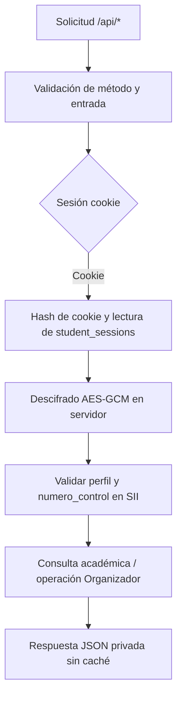

Las funciones están configuradas con `auth: "none"` de Supabase porque la autenticación de negocio se implementa con sesión institucional. Esto no deja los endpoints sin autenticación: cada función protegida exige una cookie de sesión válida. El código conserva una ruta de compatibilidad con Bearer para una transición coordinada, pero está inactiva mientras `APP_LEGACY_BEARER_ORIGINS` no esté definida; en el entorno actual esa variable se retiró. La clave publicable identifica el proyecto y no concede permisos a las tablas.

### Endpoints consumidos por el frontend

Todas las rutas se llaman bajo el prefijo del mismo origen `/api`. La clave `apikey` de Supabase identifica el proyecto; la cookie `sii_session` identifica la sesión institucional.

| Ruta | Método | Autenticación/controles | Función |
|---|---|---|---|
| `/api/auth-login` | `POST` | `apikey`, JSON y `Origin` permitido | Login institucional; establece cookie y devuelve vencimiento y CSRF. |
| `/api/auth-session` | `GET` | `apikey` y cookie | Comprueba sesión y devuelve `authenticated`, `expires_at` y `csrf_token`. |
| `/api/auth-logout` | `POST` | `apikey`, cookie, `Origin` permitido y `X-CSRF-Token` | Revoca la sesión y responde `204`. |
| `/api/student-profile` | `GET` | `apikey` y cookie | Perfil del estudiante. |
| `/api/student-grades` | `GET` | `apikey` y cookie | Calificaciones del SII. |
| `/api/student-kardex` | `GET` | `apikey` y cookie | Historial académico y avance. |
| `/api/student-schedule` | `GET` | `apikey` y cookie | Horario del semestre. |
| `/api/organizador-api/summary` | `GET` | `apikey` y cookie | Totales, vencimientos, carga y prioridad. |
| `/api/organizador-api/activities` | `GET` | `apikey` y cookie | Listar y filtrar actividades. |
| `/api/organizador-api/activities` | `POST` | Cookie, `Origin` permitido y CSRF | Crear actividad propia. |
| `/api/organizador-api/activities/{id}` | `GET` | `apikey` y cookie | Consultar actividad propia. |
| `/api/organizador-api/activities/{id}` | `PATCH` | Cookie, `Origin` permitido y CSRF | Modificar actividad propia. |
| `/api/organizador-api/activities/{id}` | `DELETE` | Cookie, `Origin` permitido y CSRF | Eliminar actividad propia. |

El listado acepta filtros como `search`, `status`, `priority`, `activity_type`, `subject`, `due_from` y `due_to`, además de `limit` y `offset`. Los valores permitidos, límites, formatos de respuesta y errores están descritos en [`docs/openapi.yaml`](docs/openapi.yaml). Los ejemplos del contrato son ilustrativos; no representan datos reales de estudiantes.

#### Parámetros del Organizador

| Parámetro | Uso |
|---|---|
| `search` | Busca texto asociado a título, descripción o materia. |
| `status` | `pendiente`, `en_progreso` o `completada`. |
| `priority` | `baja`, `media` o `alta`. |
| `activity_type` | `tarea`, `proyecto`, `examen` u `otro`. |
| `subject` | Filtra por materia. |
| `due_from`, `due_to` | Acota el rango de vencimiento con fecha/hora RFC 3339 y zona horaria. |
| `limit`, `offset` | Paginación validada en servidor; el frontend usa tamaño de 20. |

Las mutaciones admiten una lista explícita de campos (`title`, `description`, `subject`, `activity_type`, `due_date`, `priority`, `status`, `estimated_minutes`). El servidor rechaza campos desconocidos, incluido `student_id`, comprueba enumeraciones, longitudes y fechas RFC 3339. Las operaciones sobre `/activities/{id}` también verifican que el UUID exista bajo el propietario autenticado; una actividad de otro estudiante no puede modificarse por conocer su ID.

### Modelo del API y responsabilidades

| Operación | Fuente/almacenamiento | Identidad usada |
|---|---|---|
| Login y validación de JWT | SII ITC | Credenciales enviadas al endpoint institucional solo desde Edge Function. |
| Perfil, calificaciones, Kardex y horario | SII ITC en vivo | JWT institucional descifrado en servidor y enviado como Bearer al SII. |
| Actividades y resumen | PostgreSQL propio | `numero_control` recuperado de un perfil validado; nunca se acepta del body como propietario. |
| Estado de sesión | PostgreSQL propio | Hash de cookie aleatoria como identificador de sesión. |

Así se conserva al SII como fuente de verdad académica y al backend propio como responsable de sesiones de la aplicación y de la funcionalidad adicional.

### Contrato y errores

Las funciones devuelven JSON con `Cache-Control: no-store`. Los errores usan la forma `error.code` y `error.message`; entre los códigos normalizados están `BAD_REQUEST`, `INVALID_CREDENTIALS`, `INVALID_SESSION`, `CSRF_REJECTED`, `SII_UNAVAILABLE`, `SII_UPSTREAM_ERROR`, `SII_INVALID_RESPONSE` y `DATABASE_ERROR`. El backend también normaliza el caso institucional en que el SII puede responder HTTP 200 con un error de credenciales dentro del JSON.

## Sesiones y seguridad

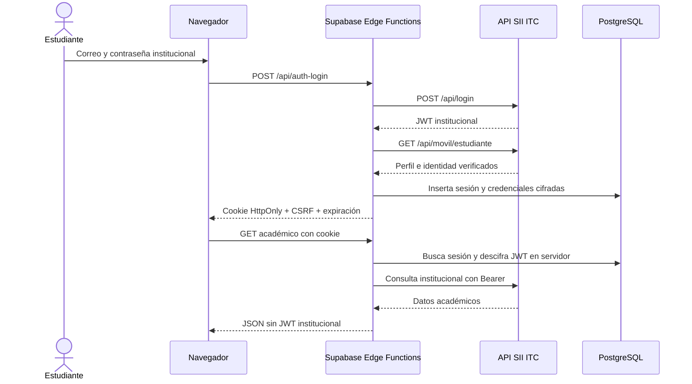

*Diagrama 3. La API institucional valida credenciales y datos; el JWT permanece en el backend.*

- **Cookie opaca:** `sii_session` contiene un identificador aleatorio; usa `HttpOnly`, `Secure`, `SameSite=Lax` y `Path=/api`. El navegador no puede leerla desde JavaScript y la envía automáticamente al mismo origen.
- **Sesión en servidor:** la base guarda el hash SHA-256 del identificador, no el identificador en claro. El JWT institucional y CSRF se cifran con AES-GCM; se guardan IV separados. El token CSRF también se verifica contra un hash.
- **Caducidad:** la sesión no supera la expiración `exp` del JWT del SII ni el máximo de ocho horas configurado en la función.
- **Validación institucional:** el backend verifica el perfil contra el SII al crear/restaurar sesión y las consultas protegidas vuelven a comprobar que el `numero_control` coincida con el de la sesión.
- **CSRF:** operaciones mutables del Organizador y logout validan origen exacto y `X-CSRF-Token`. Los GET protegidos usan cookie y autenticación de sesión.
- **Aislamiento:** el propietario de actividades se deriva del `numero_control` verificado; el cliente no puede fijar `student_id`. RLS está habilitado y las tablas no conceden acceso a `anon` o `authenticated`; el backend usa el contexto de servicio.
- **Respuestas:** se deshabilita caché de respuestas de autenticación y datos privados. Los mensajes inesperados del runtime se normalizan y no se devuelven directamente al cliente.
- **Clave de cifrado:** mantener estable `SESSION_ENCRYPTION_KEY` entre despliegues. Cambiarla impide descifrar las sesiones existentes; coordina la rotación y el cierre de sesiones.

## Base de datos y Organizador Académico

### Tablas

| Tabla | Datos principales | Protección |
|---|---|---|
| `student_sessions` | Hash de sesión, identidad institucional, token SII cifrado, CSRF cifrado/hash, expiración y revocación. | RLS habilitado; acceso exclusivo al rol de servicio desde funciones. |
| `academic_activities` | Propietario, título, descripción, materia, tipo, fecha límite, prioridad, estado, estimación y timestamps. | RLS habilitado; sin acceso directo para `anon`/`authenticated`; solo función de backend. |

La migración de actividades define validaciones de longitud y dominios permitidos, índices para propietario/fecha/estado/prioridad/tipo y un trigger para actualizar `updated_at`. Las fechas se almacenan como `TIMESTAMPTZ` y el API exige formato RFC 3339 con zona horaria.

### Reglas del resumen

- Actividades vencidas y próximas se calculan solo sobre actividades no completadas.
- Las ventanas de vencimiento comprenden próximas 48 horas y próximos siete días.
- La carga suma los minutos estimados de actividades abiertas dentro de los próximos siete días. Se marca como completa, parcial o no disponible cuando faltan estimaciones.
- Los días con al menos dos actividades próximas aparecen como concentraciones de entregas.
- El backend calcula puntuación, nivel y razones de urgencia combinando vencimiento, prioridad y estado.
- El agrupamiento de fechas del resumen usa `America/Mexico_City`.

## Tecnologías

| Tecnología | Uso |
|---|---|
| React 19.3.1 | Interfaz basada en componentes. |
| React Router 7 | Rutas públicas y privadas. |
| Vite 8.3.5 | Desarrollo, compilación y proxy local `/api`. |
| Tailwind CSS 4 | Estilos responsivos. |
| Axios | Solicitudes HTTP del frontend. |
| Supabase Edge Functions (Deno) | API local, integración institucional y lógica de negocio. |
| Supabase PostgreSQL | Sesiones y actividades persistentes. |
| Vercel | Hosting SPA y rewrites de API. |

## Instalación y ejecución local

### Requisitos

- Node.js y npm compatibles con las versiones del proyecto.
- Proyecto Supabase preparado con migraciones, funciones y secretos.
- Clave publicable de Supabase para el frontend.
- Credenciales institucionales válidas para probar contra el SII ITC.

### Ejecutar el frontend

1. Clona el repositorio e instala dependencias:

   ```bash
   git clone https://github.com/P4quiton/sii-itc-web.git
   cd sii-itc-web
   npm ci
   ```

2. Crea `.env.local` desde el ejemplo:

   ```bash
   cp .env.example .env.local
   ```

3. Configura los valores del proyecto Supabase al que se desplegó el backend:

   ```dotenv
   VITE_SUPABASE_URL=https://<PROJECT_REF>.supabase.co
   VITE_SUPABASE_PUBLISHABLE_KEY=<CLAVE_PUBLICABLE>
   ```

4. Inicia Vite:

   ```bash
   npm run dev
   ```

5. Abre la URL local indicada por Vite. `vite.config.js` reenvía `/api/*` al proyecto definido en `VITE_SUPABASE_URL` y reemplaza `/api` por `/functions/v1`.

Para que el Login local funcione, agrega `http://localhost:5173` a `APP_ALLOWED_ORIGINS` en los secretos del proyecto Supabase usado por el proxy. Si no está autorizado, la Edge Function puede responder HTTP 403 con `CSRF_REJECTED`, aunque Vite y el frontend estén funcionando correctamente. Retira el origen local cuando ya no lo necesites.

La `publishable key` es pública y se envía como encabezado `apikey`; **no** es un token de sesión, no sustituye CSRF y no debe ser una clave `service_role`. Nunca uses prefijo `VITE_` para secretos de servidor o credenciales institucionales.

### Comandos disponibles

| Comando | Descripción |
|---|---|
| `npm run dev` | Servidor local de Vite. |
| `npm run build` | Compilación de producción en `dist/`. |
| `npm run preview` | Previsualiza localmente el build. |
| `npm run lint` | Ejecuta ESLint. |

## Configuración y despliegue del backend

### 1. Seleccionar el proyecto Supabase

Instala/usa la CLI de Supabase desde el proyecto y vincula el repositorio al proyecto destino:

```bash
npx supabase login
npx supabase link --project-ref <PROJECT_REF>
npx supabase migration list --remote
```

Antes de aplicar migraciones o desplegar, confirma que el proyecto vinculado sea el entorno correcto. `supabase link` cambia el destino de CLI local; revisa siempre la salida del comando.

### 2. Configurar secretos de Edge Functions

Configura los secretos en Supabase Dashboard → **Edge Functions → Secrets** o mediante Supabase CLI. No los guardes en `.env.local`, variables `VITE_*`, commits, README, issues ni capturas.

| Variable | Requerida | Finalidad |
|---|---:|---|
| `SESSION_ENCRYPTION_KEY` | Sí | Clave Base64 que representa 32 bytes para AES-GCM y protege JWT SII/CSRF persistidos. |
| `APP_ALLOWED_ORIGINS` | Sí | Lista separada por comas de orígenes web exactos autorizados, incluyendo esquema y host, sin comodines. |
| `APP_LEGACY_BEARER_ORIGINS` | No, compatibilidad temporal | El código aún conserva el flujo anterior Bearer para orígenes explícitos, pero la variable está sin configurar en el entorno actual y esa ruta permanece inactiva. No la configures salvo durante una transición coordinada. |

Supabase proporciona al runtime los valores de proyecto/servicio usados por `withSupabase` y `ctx.supabaseAdmin`. La credencial privilegiada de servicio nunca se configura en el frontend ni se entrega al navegador.

`APP_ALLOWED_ORIGINS` debe contener el dominio de producción y solo los Preview expresamente necesarios, por ejemplo `https://<dominio-produccion>` y, si procede, `https://<preview-autorizado>`. El backend compara orígenes completos exactos. No uses `*.vercel.app` ni el valor de una URL de Preview como sustituto permanente del origen de producción.

### 3. Aplicar migraciones

Revisa qué migraciones faltan y, cuando hayas confirmado el destino, aplícalas:

```bash
npx supabase migration list --remote
npx supabase db push --dry-run --remote
npx supabase db push --remote
```

Migraciones del repositorio:

1. `20261105032817_create_academic_activities.sql`
2. `20261105120000_create_persistent_sessions.sql`

El `dry-run` permite revisar el conjunto pendiente. `db push` modifica la base remota, así que comprueba el proyecto y el plan antes de confirmar.

### 4. Desplegar las Edge Functions

Después de configurar secretos y migraciones, despliega las ocho funciones al proyecto vinculado:

```bash
npx supabase functions deploy auth-login
npx supabase functions deploy auth-session
npx supabase functions deploy auth-logout
npx supabase functions deploy student-profile
npx supabase functions deploy student-grades
npx supabase functions deploy student-kardex
npx supabase functions deploy student-schedule
npx supabase functions deploy organizador-api
```

Si la CLI solicita confirmación, revisa otra vez el nombre del proyecto y el entorno destino. El despliegue no requiere ni debe incluir secretos dentro de los archivos fuente.

### 5. Comprobaciones posteriores

- Confirma en Supabase que las dos migraciones aparecen aplicadas y que están desplegadas las ocho funciones.
- Confirma que `SESSION_ENCRYPTION_KEY` y `APP_ALLOWED_ORIGINS` estén cargadas en el proyecto Supabase correcto.
- Prueba login, `Set-Cookie`, restauración `GET /api/auth-session`, consultas del SII y logout.
- Prueba una operación del Organizador con CSRF vigente y, en un entorno de prueba, rechazo con CSRF ausente/incorrecto.
- Confirma que cookies y encabezados `Origin`/`X-CSRF-Token` se reenvíen a través del rewrite del deployment.

## Despliegue del frontend

Vercel sirve el build de Vite como SPA. `vercel.json` incluye primero el rewrite de `/api/:path*` hacia Supabase Functions y después el fallback de rutas del frontend a `index.html`; mantener este orden permite resolver tanto API como rutas de React Router.

Configura en el entorno de Vercel la clave publicable que usa el cliente HTTP. La URL del proyecto se requiere en `.env.local` para el proxy de desarrollo; el rewrite de producción apunta al proyecto indicado en `vercel.json`.

| Variable | Uso |
|---|---|
| `VITE_SUPABASE_URL` | URL del proyecto Supabase usada por el proxy de desarrollo de Vite. No es necesaria para el rewrite de Vercel, cuyo destino está fijado en `vercel.json`. |
| `VITE_SUPABASE_PUBLISHABLE_KEY` | Clave publicable enviada como encabezado `apikey` en las solicitudes a Supabase. Es visible en el bundle del navegador y no debe ser una clave `service_role`. |

El destino del rewrite de producción también está declarado en `vercel.json`; si se cambia el proyecto Supabase, alinea ese destino con la configuración del entorno frontend. Añade el dominio de producción a `APP_ALLOWED_ORIGINS` en Supabase. En Preview, autoriza solo el origen Preview que se vaya a probar y retíralo al terminar si ya no se necesita.

`APP_ALLOWED_ORIGINS` es un secreto de backend configurado en Supabase, no una variable `VITE_*` ni una variable que se configure en Vercel. `SESSION_ENCRYPTION_KEY` también es exclusiva del backend. Las variables `VITE_SUPABASE_URL` y `VITE_SUPABASE_PUBLISHABLE_KEY` son configuración pública del frontend y no contienen credenciales institucionales ni claves privilegiadas.

## Capturas de pantalla

Esta galería reúne vistas de la interfaz de SII ITC Web en sus secciones principales. Las imágenes publicadas representan la versión desplegada y protegen los datos personales del estudiante.

| Inicio de sesión | Dashboard y perfil | Calificaciones |
|:---:|:---:|:---:|
| 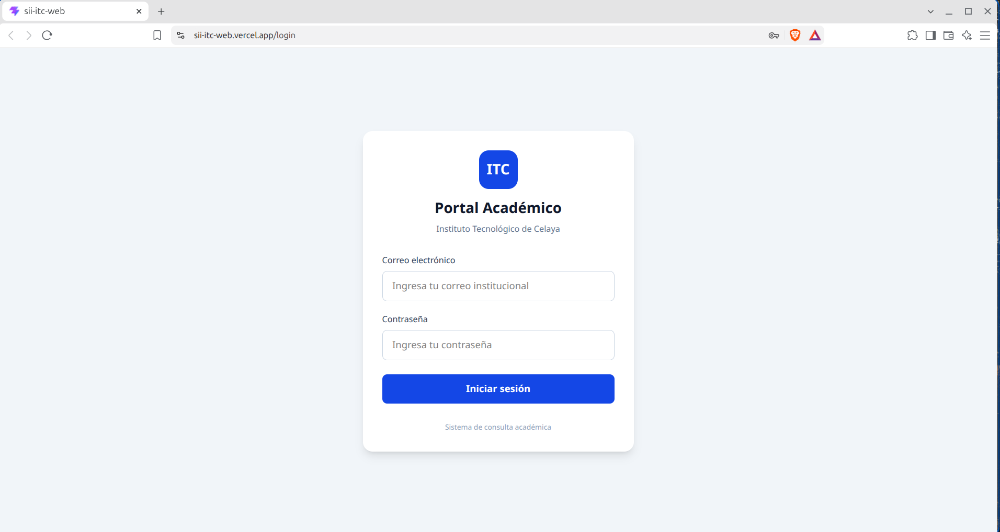 | 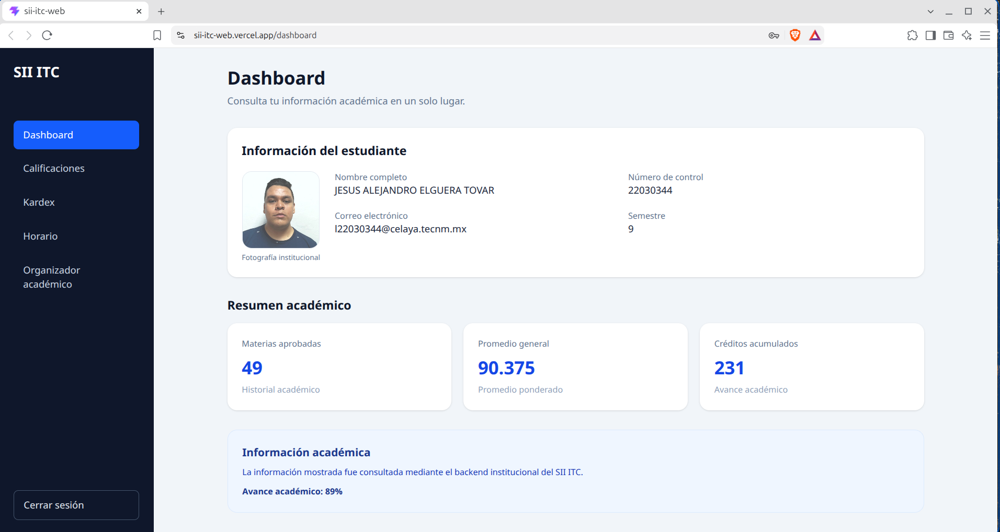 | 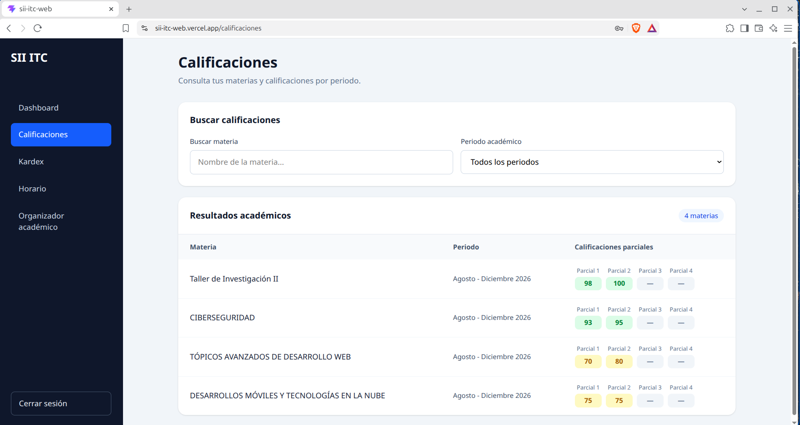 |

| Kardex | Horario | Organizador y calendario |
|:---:|:---:|:---:|
| 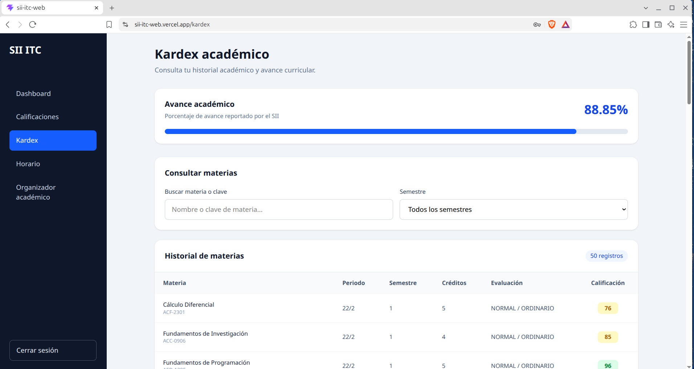 | 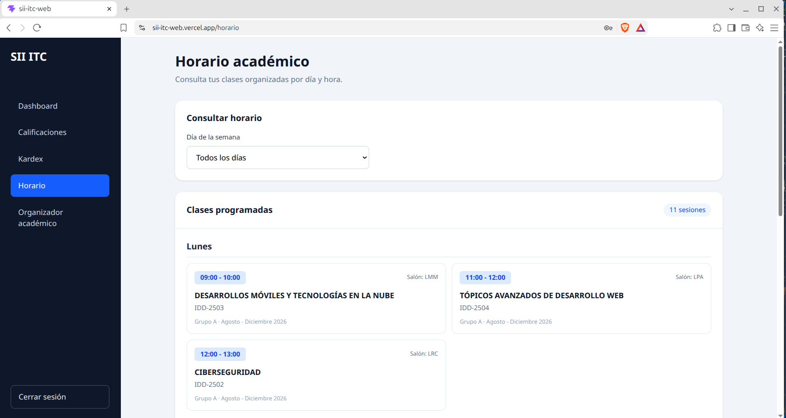 | 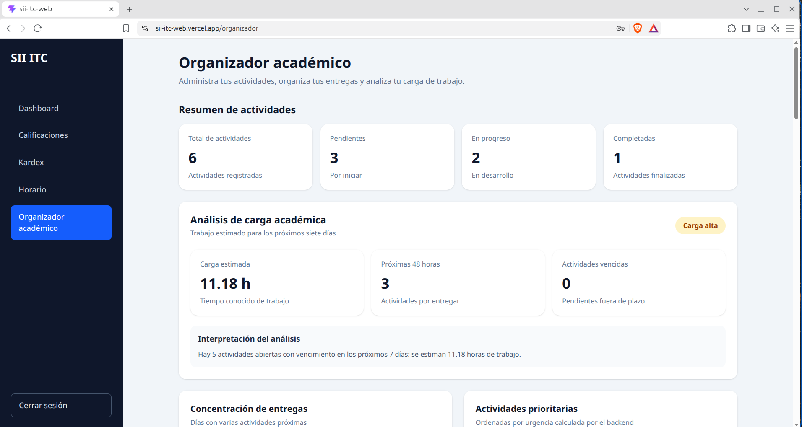 |

### Evidencias de Supabase

Esta galería complementa las vistas de la aplicación con evidencia de la infraestructura backend desplegada.

| Edge Functions desplegadas | Esquema de tablas|
|:---:|:---:|
| 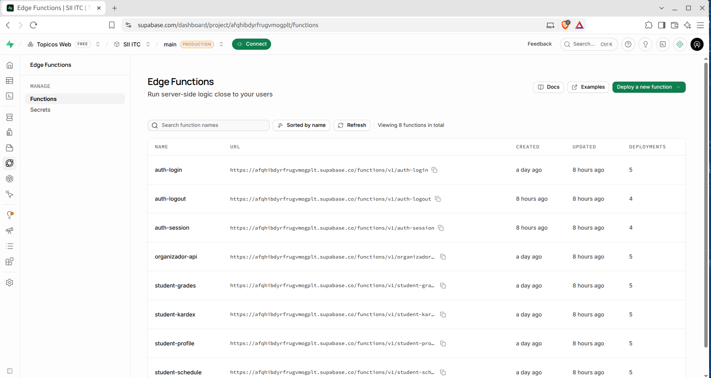 | 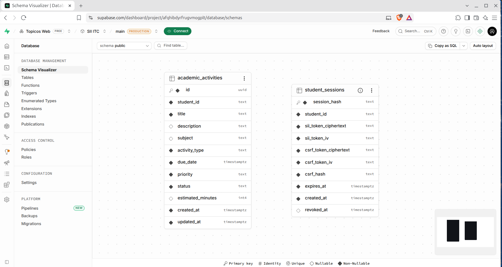 |

Las capturas de base de datos muestran únicamente el esquema; no exponen filas de sesiones, datos de estudiantes, JWT, cookies, hashes, claves, secretos ni información de conexión.
